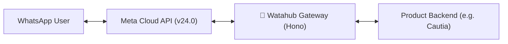

# 🌊 watahub

[](https://opensource.org/licenses/MIT)
[](https://www.typescriptlang.org/)
[](https://hono.dev/)
[](https://vitest.dev/)

> **What a hub for WhatsApp!**  
> An open-source, high-performance WhatsApp Cloud API Gateway and Infrastructure (IaaS) built with [Hono](https://hono.dev). Connect your apps directly to Meta Cloud API with **zero middleman markups**, multi-tenant Embedded Signup, instant webhook normalization, cryptographic signature validation, and phone-level callback routing.

Built with ❤️ by [Hub Ventures](https://github.com/Hub-Ventures).

---

## ⚡ Why Watahub?

Most WhatsApp gateway providers charge extra message markups, enforce vendor lock-in, or add unnecessary latency. **Watahub** is designed as a direct self-hostable bridge between Meta's Graph API and your application ecosystem:

* 🚀 **Zero Middleman Markup:** Pay only Meta's official conversation rates directly.
* ⚡ **Ultra-lightweight & Fast:** Built on Hono with Web Standards (`crypto.subtle`, `fetch`), running seamlessly on **Cloudflare Workers**, **Node.js**, or **Bun**.
* 🔐 **Cryptographic Verification:** Automatic HMAC-SHA256 verification of incoming Meta webhooks (`X-Hub-Signature-256`) and outgoing subscriber payload signing (`X-Watahub-Signature`).
* 🔄 **Event Normalization:** Transforms Meta's deeply nested webhook structures into clean, standardized event payloads (text, audio, images, documents, interactive button/list replies, delivery status receipts).
* 🏢 **Embedded Signup & Multi-Tenant:** Direct support for OAuth code exchange, WABA subscription, and per-phone webhook callback overrides.
* 🛡️ **Production-Hardened Error Engine:** Automated categorization of Meta Graph API errors (Rate Limits `130429`, Auth Expiry `190`, Billing/Payment Failures `131042`, Transient Failures `131016`).

---

## 📐 Architecture



---

## 📦 Quick Start

### 1. Installation

```bash
git clone https://github.com/Hub-Ventures/watahub.git
cd watahub
pnpm install
```

### 2. Environment Configuration

Copy the example environment file:

```bash
cp .env.example .env
```

Configure your environment variables:

| Variable | Description | Default |
| :--- | :--- | :--- |
| `PORT` | Local Node.js server port | `3000` |
| `META_APP_ID` | Meta Developer App ID | - |
| `META_APP_SECRET` | Meta Developer App Secret (used for HMAC verification) | - |
| `META_SYSTEM_USER_TOKEN` | Meta System User permanent access token | - |
| `META_WEBHOOK_VERIFY_TOKEN` | Custom token for Meta webhook handshake | - |
| `META_DEFAULT_PHONE_NUMBER_ID` | Default WhatsApp Business Phone Number ID | - |
| `META_DEFAULT_WABA_ID` | Default WhatsApp Business Account ID | - |
| `META_API_VERSION` | Graph API Version | `v24.0` |
| `SUBSCRIBER_WEBHOOK_URL` | Forwarding destination URL (e.g. your backend) | - |
| `SUBSCRIBER_WEBHOOK_SECRET` | Shared secret to sign subscriber deliveries | - |
| `WATAHUB_API_KEY` | Optional API key to protect `/v1/*` routes | - |

---

## 🚀 Running Watahub

### Development (Node.js)
```bash
pnpm run dev:node
```

### Development (Cloudflare Workers via Wrangler)
```bash
pnpm run dev
```

### Typecheck, Lint & Test Suite
```bash
pnpm check   # typecheck + lint + format check + tests with coverage
```

See [CONTRIBUTING.md](CONTRIBUTING.md) for the code layout and conventions.

### Deploy to Cloudflare Workers
```bash
pnpm run deploy
```

---

## 📡 API Reference

### 1. Gateway Health
* `GET /health`  
Returns service status, version, and server timestamp.

### 2. Webhooks
* `GET /webhook`  
Handles Meta's initial challenge handshake verification (`hub.mode`, `hub.verify_token`, `hub.challenge`).
* `POST /webhook`  
Receives raw webhooks from Meta, verifies `X-Hub-Signature-256`, normalizes events, dispatches them asynchronously to `SUBSCRIBER_WEBHOOK_URL`, and returns an immediate `200 OK`.

### 3. Outbound Messages
* `POST /v1/messages`  
Unified endpoint to send text, templates, media, reactions, and interactive components.

**Sample Request (Text Message):**
```json
POST /v1/messages
Content-Type: application/json
Authorization: Bearer <WATAHUB_API_KEY>

{
  "to": "+15551234567",
  "phoneNumberId": "100609346426000",
  "kind": "text",
  "text": {
    "body": "Hello from Watahub!"
  }
}
```

**Sample Request (Template Message):**
```json
POST /v1/messages
Content-Type: application/json

{
  "to": "+15551234567",
  "phoneNumberId": "100609346426000",
  "kind": "template",
  "template": {
    "name": "welcome_confirmation",
    "language": {
      "code": "es"
    }
  }
}
```

### 4. Template Management
* `GET /v1/templates/:wabaId`  
Lists approved HSM templates directly from Meta Graph API.

### 5. Onboarding & Multi-Tenancy
* `POST /v1/onboarding/exchange`: Exchanges Meta Embedded Signup `code` for an access token.
* `POST /v1/onboarding/subscribe`: Subscribes application to WABA message webhooks.
* `POST /v1/onboarding/override-callback`: Overrides webhook routing URL for an individual phone number.

---

## 📄 License

This project is licensed under the [MIT License](LICENSE).
