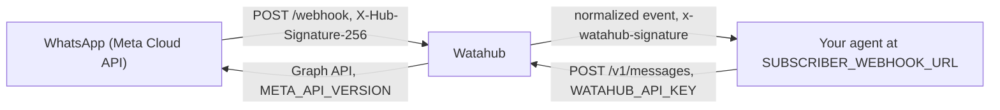

<picture>
  <source media="(prefers-color-scheme: dark)" srcset="docs/assets/watahub-mark-dark.svg">
  
</picture>

# Watahub

**The hub for your WhatsApp agents.**

1. Connect your line
2. Deploy your agents on your line
3. That's it.

This repository is the open-source engine of that hub: a self-hosted gateway between Meta's WhatsApp Cloud API and the
agents you run. Watahub is for agents that work for a business, such as support, sales or bookings. Meta's WhatsApp
Business terms do not allow a general-purpose AI assistant as the main function of an integration.

| Step | With the core |
| :--- | :--- |
| Connect your line | `POST /v1/onboarding/connect` finishes Embedded Signup and keeps the line's token. Or set `META_SYSTEM_USER_TOKEN` |
| Deploy your agents on your line | Point `SUBSCRIBER_WEBHOOK_URL` at your agent. It receives every message as a signed event and replies with `POST /v1/messages` |

The core does not host or run agents: an agent is any HTTPS service that accepts the signed event and calls the API.
The hosted pieces of the hub (token custody, the hosted Embedded Signup page, the Inbox, signed developer webhooks and
the `/mcp` endpoint) are in Watahub Enterprise Edition; see [Core and Enterprise Edition](#core-and-enterprise-edition).

One [Hono](https://hono.dev) app. It runs on Cloudflare Workers or Node.js 20+, and the same code is an importable
TypeScript library. MIT licensed, by [Hub Ventures](https://github.com/Hub-Ventures).

**Current release:** `watahub@0.2.0` on npm (2026-11-08); `main` carries the same version.



## What it gives an agent

- **Every inbound message as one flat event.** Text, media, reply-button and list choices, Flow answers, reactions,
  locations, contacts, orders and click-to-WhatsApp ad referrals, plus delivery statuses and echoes from the WhatsApp
  Business app. Meta's signature is checked over the raw body, stale and repeated deliveries are dropped, and each
  forward carries a stable delivery ID and your HMAC signature.
- **Replies through one API.** `POST /v1/messages` sends `text`, `template`, `image`, `audio`, `video`, `document`,
  `sticker`, `location`, `contacts`, `reaction` and `interactive` (buttons, lists, Flows, CTA URL, location request,
  product, product list, order details). `replyToMessageId` quotes the message being answered. The recipient is a
  phone number or a business-scoped user ID (BSUID). Outside the 24-hour customer service window, Meta accepts only
  templates.
- **Media in both directions.** Inbound files (voice notes, images, documents) download through the gateway, so the
  agent never holds a Meta token. Uploads stream to Meta without being buffered, up to 100 MB.
- **Templates**, listed one page at a time with Meta's `after` cursor.
- **Line onboarding.** One call exchanges the Embedded Signup code, stores the business token, subscribes the WABA and
  registers the number. The token is never returned.
- **A Graph passthrough** for three routes (`/v24.0/...`), so an existing Graph client can point at the gateway. It
  forwards any body Meta accepts on `/{phone-number-id}/messages` unchanged, for example marking a message as read.

It fails closed. A missing or weak secret makes the matching routes answer `503` instead of running unauthenticated.

## Quick start

Requirements: Node.js 20 or later, pnpm (`corepack enable` uses the version pinned in `package.json`), a Meta app with
the WhatsApp product, and a WhatsApp Business Account with a phone number.

```bash
git clone https://github.com/Hub-Ventures/watahub.git
cd watahub
pnpm install
cp .env.example .env
```

Fill in `.env`. Generate `WATAHUB_API_KEY` and, later, `SUBSCRIBER_WEBHOOK_SECRET` with `openssl rand -hex 32`.

| Variable | Value |
| :--- | :--- |
| `META_APP_SECRET` | Your Meta app's secret (App settings, Basic) |
| `META_WEBHOOK_VERIFY_TOKEN` | Any string of 16+ characters; you type the same value into Meta's webhook settings |
| `WATAHUB_API_KEY` | 32+ characters; every `/v1` and `/v24.0` call must carry it |
| `META_SYSTEM_USER_TOKEN` | A system user token with `whatsapp_business_messaging` and `whatsapp_business_management`, unless you connect lines through `POST /v1/onboarding/connect` |

To receive messages, also set `SUBSCRIBER_WEBHOOK_URL` (your agent's HTTPS endpoint) and `SUBSCRIBER_WEBHOOK_SECRET`
(32+ characters). Every variable is listed under [Configuration](#configuration).

The gateway reads `process.env` and does not load `.env` by itself, so start it with Node's `--env-file` (Node 20.6
or later):

```bash
pnpm exec tsx watch --env-file=.env src/node.ts   # http://localhost:3000, reloads on change
curl http://localhost:3000/health
```

```json
{ "status": "ok", "service": "watahub", "version": "0.2.0", "timestamp": "2026-11-08T15:30:00.000Z" }
```

Send a message:

```bash
curl -X POST http://localhost:3000/v1/messages \
  -H "Authorization: Bearer $WATAHUB_API_KEY" \
  -H "Content-Type: application/json" \
  -d '{ "to": "+15551234567", "phoneNumberId": "100609346426000", "kind": "text", "text": { "body": "Hello" } }'
```

```json
{ "success": true, "messageId": "wamid.HBgL...", "recipient": "15551234567", "phoneNumberId": "100609346426000" }
```

To receive messages, expose the gateway over HTTPS (`cloudflared tunnel` or `ngrok`). In the Meta app, set the
webhook callback to `https://<public-host>/webhook` and the verify token to `META_WEBHOOK_VERIFY_TOKEN`. Then
subscribe to the `messages` field. [Getting started](docs/GETTING_STARTED.md) walks through each step.

> [!NOTE]
> On Node, `src/node.ts` validates the configuration at boot and refuses to start on a missing, short or placeholder
> value, naming each variable. Workers, and apps that import the library, have no boot step: each route checks the
> variables it reads on every request and answers `503` when one is invalid.

## Routes

`/v1/*` and `/v24.0/*` require `WATAHUB_API_KEY` as `Authorization: Bearer <key>` or `X-API-Key: <key>`. The full
contract, with bodies and errors, is in the [API reference](docs/API_REFERENCE.md).

| Method | Path | Auth | What it does |
| :--- | :--- | :--- | :--- |
| `GET` | `/health` | None | Status, service name, version and server time (ISO 8601) |
| `GET` | `/webhook` | Verify token | Meta's subscription handshake; answers `hub.challenge` |
| `POST` | `/webhook` | Meta signature | Verifies, normalizes and forwards one Meta delivery |
| `POST` | `/v1/messages` | API key | Sends one message |
| `POST` | `/v1/media`, `/v1/media/:phoneNumberId` | API key | Streams a `multipart/form-data` upload to Meta; returns `{ id }` |
| `GET` | `/v1/media/:mediaId` | API key | Resolves the temporary CDN URL; `?redirect=true` answers `302` |
| `GET` | `/v1/media/:mediaId/content` | API key | Downloads the file through the gateway |
| `GET` | `/v1/templates`, `/v1/templates/:wabaId` | API key | One page of the WABA's templates; next page with `?after=<paging.after>` |
| `GET` | `/v1/onboarding/launch` | API key | `appId`, `configurationId` and `apiVersion` for `FB.login` |
| `POST` | `/v1/onboarding/connect` | API key | Exchanges the signup code, stores the token, subscribes the WABA, registers the phone |
| `POST` | `/v1/onboarding/exchange` | API key | Exchanges the signup code and returns the token. Prefer `connect` |
| `POST` | `/v1/onboarding/subscribe` | API key | Subscribes this app to a WABA's webhooks |
| `POST` | `/v1/onboarding/override-callback` | API key | Sets a phone-level callback URL (public `https` hosts only) |
| `POST` | `/v24.0/:phoneNumberId/messages` | API key | Graph passthrough |
| `POST` | `/v24.0/:phoneNumberId/media` | API key | Graph passthrough |
| `GET` | `/v24.0/:mediaId` | API key | Graph passthrough |

Any other `/v24.0` path answers `403`. Proxied calls go to the Graph version in `META_API_VERSION`, whatever the path
prefix says.

**Meta token per call.** The gateway uses `X-Meta-Access-Token` when the caller sends it. If the call names a phone
number ID, it next tries the token stored for that line by `connect`. The last fallback is `META_SYSTEM_USER_TOKEN`.
With none of them, the call answers `500`.

## Configuration

Values come from Worker bindings first, then `process.env`. Empty values count as unset.

| Variable | Required | Default | Notes |
| :--- | :--- | :--- | :--- |
| `WATAHUB_API_KEY` | Yes | | 32+ characters. Without it `/v1` and `/v24.0` answer `503` |
| `META_APP_SECRET` | Yes | | Verifies `X-Hub-Signature-256`; also the signup code exchange. Without it `POST /webhook` answers `503` |
| `META_WEBHOOK_VERIFY_TOKEN` | Yes | | 16+ characters, compared in constant time |
| `META_SYSTEM_USER_TOKEN` | No | | Last fallback for the Meta token |
| `META_APP_ID` | No | | Numeric. Required by `launch`, `connect` and `exchange` |
| `META_CONFIGURATION_ID` | No | | Embedded Signup `config_id`, numeric. Required by `launch` |
| `META_API_VERSION` | No | `v24.0` | `v<major>.<minor>`. Used by `/v1` and by the proxy |
| `META_DEFAULT_PHONE_NUMBER_ID` | No | | Used when a send or upload names no phone number ID |
| `META_DEFAULT_WABA_ID` | No | | Used when `GET /v1/templates` names no WABA |
| `SUBSCRIBER_WEBHOOK_URL` | To receive events | | `https://`; `http://localhost` and `http://127.0.0.1` are allowed for development. Without it, deliveries that carry changes answer `503` and Meta retries |
| `SUBSCRIBER_WEBHOOK_SECRET` | With the URL | | 32+ characters; signs every forward |
| `WEBHOOK_DELIVERY_MODE` | No | `sync` | `sync` or `async`; see [Webhook delivery](#webhook-delivery) |
| `META_WEBHOOK_MAX_AGE_SECONDS` | No | `604800` | Deliveries whose newest event is older are acknowledged and not forwarded |
| `RATE_LIMIT_PER_MINUTE` | No | Off | Per-client limit on authenticated `/v1` and `/v24.0` calls |
| `TRUSTED_CLIENT_IP_HEADER` | No | | Header with the client IP when Node runs behind a proxy, e.g. `X-Real-IP` |
| `CORS_ALLOWED_ORIGINS` | No | Off | Comma-separated exact origins; no wildcards |
| `PORT` | No | `3000` | Node only |

## Webhook delivery

For every `POST /webhook`, the gateway:

1. Checks `X-Hub-Signature-256` over the raw body with `META_APP_SECRET` (`401` if it does not match).
2. Drops deliveries whose newest message or status is older than `META_WEBHOOK_MAX_AGE_SECONDS`, and bodies it has
   already delivered (`200`, `"status": "ignored"`).
3. Normalizes the `messages` and `smb_message_echoes` changes into flat events. Other fields, such as template status
   updates, are not normalized; they reach you only in `raw`.
4. Posts `{ timestamp, events, raw }` to `SUBSCRIBER_WEBHOOK_URL`.

| Mode | When Meta gets its answer | On failure |
| :--- | :--- | :--- |
| `sync` (default) | After your agent answers. One attempt, 3 s timeout | `503`, so Meta retries the same body. A final `4xx` from your agent (not 408, 425 or 429) is acknowledged with `200` and the event stays only in the gateway log |
| `async` | At once | Up to 3 attempts in the background (5 s each, 1 s and 2 s apart); a final `4xx` stops at the first. Meta is not asked to retry, so a failed event stays only in the gateway log |

Each forward carries:

| Header | Value |
| :--- | :--- |
| `x-watahub-signature` | `sha256=` and the lowercase hex HMAC-SHA256 of the exact body, keyed with `SUBSCRIBER_WEBHOOK_SECRET` |
| `x-watahub-delivery-id` | SHA-256 of Meta's raw body: the same on every retry and Meta redelivery |
| `Idempotency-Key` | Same value as `x-watahub-delivery-id` |
| `User-Agent` | `Watahub-Gateway/0.2.0` |

> [!IMPORTANT]
> Deduplicate on `x-watahub-delivery-id`. The gateway remembers delivered IDs only inside one Node process or one
> Worker isolate, so another instance can deliver the same body again.

Signature checks in TypeScript, Python and Go, and every event shape, are in
[Webhooks and events](docs/WEBHOOKS_AND_EVENTS.md).

## Security model

- **API key.** It must be 32+ characters, and the gateway compares it in constant time. After 10 failed attempts in a
  minute, a client gets `429` with `Retry-After`. A correct key is never refused.
- **Meta webhooks.** The gateway accepts only a full `sha256=` HMAC over the raw body. `GET /webhook` throttles wrong
  verify tokens the same way.
- **Graph paths.** Every ID that becomes part of a Graph path must be numeric. The proxy forwards three routes and one
  query parameter (`phone_number_id`).
- **Message sends.** The gateway never retries a send after a timeout, a lost connection or a Meta `5xx`. It answers
  `"category": "unknown_outcome"` on `/v1`, or `X-Watahub-Outcome: unknown` on the proxy.
- **Error bodies.** Responses never repeat upstream or internal error messages. Logs carry error names only, and
  request lines are redacted.
- **Callback URLs.** `override-callback` accepts only `https` URLs on public hosts. The gateway checks the hostname
  as written and does not resolve DNS.
- **Browsers.** Every response carries `Content-Security-Policy: default-src 'none'`, `X-Frame-Options: DENY`, HSTS
  and `nosniff`. Authenticated responses are `Cache-Control: no-store`, and CORS is off unless
  `CORS_ALLOWED_ORIGINS` lists origins.

Report vulnerabilities privately: see [SECURITY.md](SECURITY.md).

## Use it as a library

```bash
pnpm add watahub
```

```ts
import { createApp, DistributedLineStore } from 'watahub'

// A Hono app; app.fetch is a standard fetch handler for Workers, Node (@hono/node-server) or tests
const app = createApp({ lineStore: new DistributedLineStore(myKeyValueStore) })
```

`createApp` takes the collaborators it should use instead of the defaults. They are the Meta client factory, `fetch`,
the clock, the logger, and the replay, rate-limit and line stores. The package also exports the pieces on their own:
`MetaClient`, `normalizeMetaWebhook`, `verifyMetaSignature`, `signSubscriberPayload`, `deliverToSubscriber`,
`isStale`, `DeliveryIdCache`, the `Distributed*Store` adapters and every request and event type. See
[Extensions and Enterprise Edition](docs/MULTI_TENANCY_AND_EXTENSIONS.md).

> [!WARNING]
> The default stores live in memory, one per `createApp()`. On Workers, the stock `wrangler.jsonc` deploys
> `createApp()` with those defaults. A token stored by `connect` then lives only in the isolate that handled the call,
> and replay protection and rate limits are per isolate. Pass a `KeyValueStore` adapter for state that must outlive
> the isolate.

## Core and Enterprise Edition

This repository is the open core: one operator, one Meta app, one API key, one subscriber and any number of phone
lines. Hub Ventures also builds **Watahub Enterprise Edition**, a private, commercially licensed multi-tenant gateway
on Cloudflare Workers and a SQLite Durable Object. EE installs the published `watahub` package at an exact version and
wraps it; it never patches or forks it. It mounts `createApp(coreOverrides)` behind its tenant guard, injecting its own
`fetch`, Meta client, logger and line store. It runs its own `/webhook` with the core's `verifyMetaSignature`,
`normalizeMetaWebhook` and `isStale`. A change to an exported function, type or `GatewayDeps` port is therefore a
change to EE's contract.

| | Core (this repository, MIT) | Enterprise Edition (private) |
| :--- | :--- | :--- |
| Accounts | One operator | Many tenants, each with its own API keys, phones and WABAs |
| Meta tokens | Request header, line store or `META_SYSTEM_USER_TOKEN` | Custody: tokens stay sealed in the gateway; tenants hold only revocable Watahub API keys |
| Authorization | Anyone with the API key reaches every line | Every phone, WABA and media ID is checked against the tenant |
| Webhook delivery | One signed POST per Meta delivery, `sync` or `async` | Durable outbox with retries, per-phone destinations and developer webhooks (`X-Webhook-Signature`, `X-Idempotency-Key`) |
| Onboarding | `/v1/onboarding/*` | Core `connect` for phones an administrator assigned, a hosted connect page and setup links; core `exchange` and `override-callback` are closed |
| Interface | HTTP API and library | Superadmin console and an installable account panel with the Inbox, logs and Web Push |
| Billing | None | Prepaid credit; a paused account cannot send or connect numbers |
| Tooling | | CLI and the `/mcp` endpoint |

## Documentation

| Guide | Covers |
| :--- | :--- |
| [Getting started](docs/GETTING_STARTED.md) | Meta app, local run, first message, first webhook |
| [API reference](docs/API_REFERENCE.md) | Every route, request and response bodies, error shapes |
| [Webhooks and events](docs/WEBHOOKS_AND_EVENTS.md) | Delivery modes, headers, signature checks, event catalog |
| [Architecture](docs/ARCHITECTURE.md) | Middleware order, ports, retries and error classification |
| [Deployment](docs/DEPLOYMENT.md) | Cloudflare Workers, Node and Docker, reverse proxy, checklist |
| [Extensions and Enterprise Edition](docs/MULTI_TENANCY_AND_EXTENSIONS.md) | Library use, shared stores, how EE wraps the core |
| [Contributing](CONTRIBUTING.md) | Setup, checks, code layout, conventions |

## Development

```bash
pnpm check        # typecheck, ESLint, Prettier, Vitest with coverage
pnpm dev:worker   # wrangler dev
pnpm build        # tsc to dist/
```

`pnpm check` fails below 95% statements, lines and functions or 90% branches. The suites stub `fetch` and never call
Meta, so they do not prove live Graph behavior. `.github/workflows/ci.yml` targets Node 20 and 22. Bun and other
runtimes are not tested.

## License

[MIT](LICENSE)
