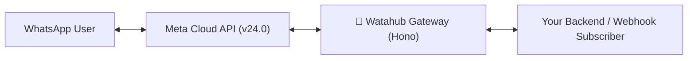

# 🌊 watahub

[](https://opensource.org/licenses/MIT)
[](https://www.typescriptlang.org/)
[](https://hono.dev/)
[](https://vitest.dev/)

> **What a hub for WhatsApp!**  
> An open-source, high-performance WhatsApp Cloud API Gateway and Bridge built with [Hono](https://hono.dev). Connect your applications directly to Meta's Cloud API with **zero middleman markups**, normalized webhook events, cryptographic HMAC verification, streaming media uploads, and an importable library architecture.

Built with ❤️ by [Hub Ventures](https://github.com/Hub-Ventures).

---

## 🎯 What is Watahub and Who is it For?

**Watahub** is designed for engineering teams and developers who already use or plan to use the official Meta WhatsApp Cloud API and want:
1. **Total Infrastructure Control:** Self-host your own gateway on Cloudflare Workers, Node.js, or Bun.
2. **Zero Markups:** Pay Meta's official conversation rates directly without third-party SaaS surcharges.
3. **Clean Developer Experience:** Receive normalized, flat JSON events instead of navigating Meta's deeply nested webhook structures.
4. **Hardened Security by Default:** Cryptographic signature validation, replay protection, and rate limiting out of the box.

---

## 📚 Documentation Suite

- 📖 [**Getting Started Guide**](docs/GETTING_STARTED.md): Step-by-step walkthrough from prerequisites to your first message and webhook.
- 📡 [**API Reference**](docs/API_REFERENCE.md): Full endpoints specification, schemas, and interactive examples for all routes.
- 🔔 [**Webhooks & Event Catalog**](docs/WEBHOOKS_AND_EVENTS.md): HMAC verification in TypeScript, Python & Go, deduplication, and normalized event JSONs.
- 📐 [**Architecture & Design**](docs/ARCHITECTURE.md): Deep dive into ports & adapters, dependency inversion, request lifecycles, and error engine.
- 🏢 [**Multi-Tenancy & Extensibility**](docs/MULTI_TENANCY_AND_EXTENSIONS.md): Scaling with `PhoneDirectory`, KV adapters, and custom enterprise databases.
- 🚢 [**Production Deployment**](docs/DEPLOYMENT.md): Production setups for Cloudflare Workers, Node.js (Docker/PM2), and Nginx reverse proxies.

---

## ⚡ Why Watahub?

* 🚀 **Zero Middleman Markup:** Pay only Meta's official conversation fees directly to Meta.
* ⚡ **Ultra-lightweight & Fast:** Built on Hono with Web Standards (`crypto.subtle`, `fetch`, `ReadableStream`).
* 🔄 **Event Normalization:** Transforms Meta's deeply nested webhook envelopes into clean, standardized event payloads (text, media, interactive buttons/lists, reactions, delivery status receipts).
* 🔐 **Cryptographic Verification:** Automatic HMAC-SHA256 verification of incoming Meta webhooks (`X-Hub-Signature-256`) and outgoing subscriber payload signing (`X-Watahub-Signature`).
* 📤 **Streaming Media Support:** Native `/v1/media` endpoints and streaming proxy passthrough that handle uploads up to 100 MB without isolate memory buffering.
* 🏢 **Pluggable Multi-Tenant Routing:** Modular `PhoneDirectory` port to dynamically resolve Meta access tokens and subscriber webhook targets per phone number.
* 🛡️ **Production-Hardened Error Engine:** Automated classification of Meta Graph API errors (Rate Limits `130429`, Auth Expiry `190`, Billing/Payment Failures `131042`, Transient Network Failures `131016`).

---

## 📐 Architecture



---

## 📋 Prerequisites

Before setting up Watahub, ensure you have:

1. **Meta for Developers Account:** An App with the **WhatsApp** product configured ([Meta Developer Portal](https://developers.facebook.com/)).
2. **WhatsApp Business Account (WABA):** A configured WABA with at least one verified phone number ID.
3. **Node.js Environment:** Node.js 20 or higher and `pnpm` (required for local development and build steps).
4. *(Optional for Cloudflare Workers)*: A Cloudflare account and Wrangler CLI installed (`pnpm dlx wrangler`).

---

## 📦 Quick Start: From Zero to First Message

### 1. Clone & Install

```bash
git clone https://github.com/Hub-Ventures/watahub.git
cd watahub
pnpm install
```

### 2. Environment Configuration

Copy the example environment file:

```bash
cp .env.example .env
```

Generate strong keys (min 32 characters) for your gateway and subscriber:

```bash
# Generate WATAHUB_API_KEY
openssl rand -hex 32

# Generate SUBSCRIBER_WEBHOOK_SECRET
openssl rand -hex 32
```

Configure your `.env`:

| Variable | Description | Default |
| :--- | :--- | :--- |
| `PORT` | Local Node.js server port | `3000` |
| `META_APP_ID` | Meta Developer App ID | - |
| `META_APP_SECRET` | **Required.** Meta App Secret, used to verify `X-Hub-Signature-256`. Without it `POST /webhook` answers 503 | - |
| `META_SYSTEM_USER_TOKEN` | Meta System User permanent access token | - |
| `META_WEBHOOK_VERIFY_TOKEN` | **Required.** Token for Meta's webhook handshake (min 16 characters) | - |
| `META_DEFAULT_PHONE_NUMBER_ID` | Default WhatsApp Business Phone Number ID | - |
| `META_DEFAULT_WABA_ID` | Default WhatsApp Business Account ID | - |
| `META_API_VERSION` | Graph API Version | `v24.0` |
| `WATAHUB_API_KEY` | **Required.** Key for every `/v1/*` and `/v24.0/*` call (min 32 characters). Without it those routes answer 503 | - |
| `SUBSCRIBER_WEBHOOK_URL` | Forwarding destination URL (https; `http://localhost` allowed for development) | - |
| `SUBSCRIBER_WEBHOOK_SECRET` | Required with `SUBSCRIBER_WEBHOOK_URL`. Signs deliveries (min 32 characters) | - |
| `META_WEBHOOK_MAX_AGE_SECONDS` | Signed deliveries whose newest event is older than this are acknowledged but not forwarded | `604800` (7 days) |
| `RATE_LIMIT_PER_MINUTE` | Optional per-client request limit on `/v1/*` and `/v24.0/*` | off |
| `TRUSTED_CLIENT_IP_HEADER` | Header with the real client IP when Node runs behind a reverse proxy (e.g. `X-Real-IP`) | - |
| `CORS_ALLOWED_ORIGINS` | Comma-separated exact origins allowed from browsers. No wildcards | off |

> [!NOTE]
> On Node.js, the gateway validates this configuration at boot and refuses to start if a required value is missing, too short, or retains the `.env.example` placeholder. Cloudflare Workers enforces these same rules per request on protected routes.

### 3. Start the Gateway

```bash
pnpm run dev:node
```

### 4. Verify Gateway Health

```bash
curl http://localhost:3000/health
```

Expected response:
```json
{
  "status": "ok",
  "service": "watahub",
  "version": "0.1.0",
  "timestamp": 1729620000000
}
```

### 5. Configure Meta Webhook Handshake

1. Expose your local port (e.g., via `cloudflared tunnel` or `ngrok http 3000`).
2. In your Meta Developer App Dashboard, go to **WhatsApp > Configuration > Edit Webhook**.
3. Set **Callback URL** to `https://<your-public-url>/webhook`.
4. Set **Verify Token** to the exact value of your `META_WEBHOOK_VERIFY_TOKEN`.
5. Click **Verify and Save**. Meta will send a `GET /webhook` challenge handshake that Watahub verifies in constant time.
6. Under **Webhook fields**, subscribe to `messages`.

### 6. Send Your First Message

```bash
curl -X POST http://localhost:3000/v1/messages \
  -H "Authorization: Bearer <WATAHUB_API_KEY>" \
  -H "Content-Type: application/json" \
  -d '{
    "to": "+15551234567",
    "phoneNumberId": "100609346426000",
    "kind": "text",
    "text": {
      "body": "Hello from Watahub!"
    }
  }'
```

Expected response:
```json
{
  "success": true,
  "messageId": "wamid.HBgLNTczMDAxMjM0NTY3FQIAEhgg...",
  "recipient": "15551234567",
  "phoneNumberId": "100609346426000"
}
```

### 7. Receive Your First Normalized Webhook Event

When a user replies on WhatsApp, Meta posts to Watahub's `/webhook`. Watahub verifies the HMAC signature, normalizes the payload, returns `200 OK` to Meta immediately, and forwards the signed payload to your `SUBSCRIBER_WEBHOOK_URL`.

---

## 🔄 Normalized Webhook Events

Meta's raw webhook format nests data under `entry[].changes[].value`. Watahub flattens these events into a clean, typed schema.

### Sample Forwarded Payload (`POST $SUBSCRIBER_WEBHOOK_URL`)

```json
{
  "timestamp": 1729620000000,
  "events": [
    {
      "id": "wamid.HBgLNTczMDAxMjM0NTY3FQIAEhgg...",
      "timestamp": 1729620000000,
      "phoneNumberId": "100609346426000",
      "displayPhoneNumber": "15550293848",
      "type": "message",
      "message": {
        "from": "573001234567",
        "senderName": "Jane Doe",
        "kind": "text",
        "text": "Hello Watahub!"
      }
    }
  ],
  "raw": {
    "object": "whatsapp_business_account",
    "entry": [ ... ]
  }
}
```

### Supported Event Types
- **Inbound Messages (`type: "message"`):** `text`, `image`, `audio`, `video`, `document`, `location`, `contacts`, `reaction`, and `interactive` (button replies, list selections).
- **Echoes (`type: "echo"`):** Outbound messages sent directly from the WhatsApp Business mobile app, normalized with recipient info and `isEcho: true`.
- **Status Updates (`type: "status"`):** Delivery lifecycle tracking (`sent`, `delivered`, `read`, `failed` with classified error codes).

---

## 🏢 Open Core & Enterprise Edition (/ee)

Watahub is structured as an **open core** project:

### 1. Single-Operator Core (Open Source, MIT)
The core gateway is a stateless, high-performance bridge designed for a single operator or team:
- **Zero Tenant Leakage:** The core does not manage tenants, tenant routing, or tenant API keys.
- **Operator Configuration:** Configured via `META_SYSTEM_USER_TOKEN` and `SUBSCRIBER_WEBHOOK_URL`.
- **Dynamic Override:** Supports `X-Meta-Access-Token` to override the token per request (allowing custom orchestrators or wrappers to inject credentials).
- **Library Package:** Published with standard TypeScript declarations and exports (`types` and `exports` in `package.json`). You can import `createApp`, `normalizeMetaWebhook`, `verifyMetaSignature`, `deliverToSubscriber`, and `MetaClient` directly into your application.

### 2. Enterprise Edition (`/ee`, Private Repository)
For multi-tenant SaaS platforms, agencies, and hosting providers requiring complete tenant isolation:
- **`PhoneDirectory`:** Dynamic resolution of phone credentials, access tokens, and tenant subscriber endpoints across KV, Redis, or SQL.
- **Tenant-Scoped Authentication:** Dedicated API keys per tenant with route-level enforcement that clients only access their assigned phone numbers.
- **Granular Webhook Routing:** Webhooks are routed directly to tenant-specific callbacks with tenant-specific HMAC signatures and `tenantId` payloads.
- **Token Custody & Embedded Signup:** Secure credential storage for multi-account onboarding.

### 3. Embedded Signup Flow (Core)
- `POST /v1/onboarding/exchange`: Exchanges Meta Embedded Signup OAuth `code` for an access token using the gateway's app credentials.
- `POST /v1/onboarding/subscribe`: Subscribes the WABA to WhatsApp webhook topics.
- `POST /v1/onboarding/override-callback`: Reconfigures Meta to route webhooks for a specific phone number to an external destination outside Watahub.

---

## 🚀 Running & Deploying Watahub

### Development (Node.js)
```bash
pnpm run dev:node
```

### Development (Cloudflare Workers via Wrangler)
```bash
pnpm run dev:worker
```

### Typecheck, Lint & Test Suite
```bash
pnpm check   # typecheck + eslint + prettier check + vitest with coverage
```

### Production Deploy (Cloudflare Workers)

Before deploying to Cloudflare Workers, configure required secrets using the Wrangler CLI:

```bash
npx wrangler secret put META_APP_SECRET
npx wrangler secret put META_WEBHOOK_VERIFY_TOKEN
npx wrangler secret put WATAHUB_API_KEY
npx wrangler secret put META_SYSTEM_USER_TOKEN

# Optional subscriber credentials
npx wrangler secret put SUBSCRIBER_WEBHOOK_SECRET
```

Then deploy the worker:
```bash
pnpm run deploy
```

---

## 📡 API Reference Summary

| Method | Endpoint | Description |
| :--- | :--- | :--- |
| `GET` | `/health` | Service status, version, and server timestamp |
| `GET` | `/webhook` | Meta verification handshake (`hub.challenge`) |
| `POST` | `/webhook` | Ingests Meta webhooks, verifies HMAC, normalizes & dispatches |
| `POST` | `/v1/messages` | Unified message dispatch (text, template, media, interactive) |
| `GET` | `/v1/media/:mediaId` | Resolves media ID to temporary CDN download URL |
| `POST` | `/v1/media` | Uploads media file (`multipart/form-data`) streaming to Meta |
| `POST` | `/v1/media/:phoneNumberId` | Uploads media scoped to a specific phone number |
| `GET` | `/v1/templates/:wabaId` | Lists approved HSM templates from Meta Graph API |
| `POST` | `/v1/onboarding/exchange` | Exchanges Meta Embedded Signup OAuth code |
| `POST` | `/v1/onboarding/subscribe` | Subscribes application to WABA message webhooks |
| `POST` | `/v1/onboarding/override-callback` | Overrides webhook URL for a specific phone number |
| `ALL` | `/v24.0/*` | Direct Graph API passthrough proxy for allowlisted routes |

---

## 🔒 Security Model

* **Authentication:** `/v1/*` and `/v24.0/*` require `WATAHUB_API_KEY` (in `X-API-Key` or `Authorization: Bearer`), compared in constant time. Keys must be at least 32 characters. A client address with more than 10 failed attempts in a minute receives `429 Too Many Requests` with a `Retry-After` header.
* **Inbound Webhooks:** `POST /webhook` strictly verifies `X-Hub-Signature-256`. Deliveries whose events are older than `META_WEBHOOK_MAX_AGE_SECONDS` are acknowledged with `200 OK` but dropped to protect against replay attacks.
* **Outbound Deliveries:** If `SUBSCRIBER_WEBHOOK_URL` is set without `SUBSCRIBER_WEBHOOK_SECRET`, `POST /webhook` answers `503` so Meta retries until the signing secret is configured. Forwards include `X-Watahub-Signature: sha256=...` and `X-Watahub-Delivery-Id`.
* **Streaming & Isolate Memory:** Media uploads stream directly to Meta via chunked Transfer-Encoding, preventing memory spikes and Workers isolate evictions on 100 MB payloads.
* **Pluggable State Stores:** Replay cache and rate limiting use pluggable ports (`ReplayStore`, `RateLimitStore`), defaulting to in-memory on Node and easily swapped with `DistributedReplayStore` and `DistributedRateLimitStore` on Workers.
* **Callback Overrides:** Destination URLs must be `https://` on a public host; loopback, private, link-local, and internal addresses are rejected.
* **HTTP Hardening:** Security headers (`Content-Security-Policy: default-src 'none'`, `X-Frame-Options: DENY`, HSTS, `X-Content-Type-Options: nosniff`) are set on every response. Responses on authenticated surfaces carry `Cache-Control: no-store`.

---

## 🚦 Project Status

Watahub is currently in active development (**v0.1.0**).

The core WhatsApp bridge functionality (message dispatch, streaming media uploads, HMAC verification, replay protection, rate limiting, and library exports) is production-ready and fully tested with 100% passing automated tests across Node.js and Cloudflare Workers.

---

## 📄 License

This project is licensed under the [MIT License](LICENSE).
