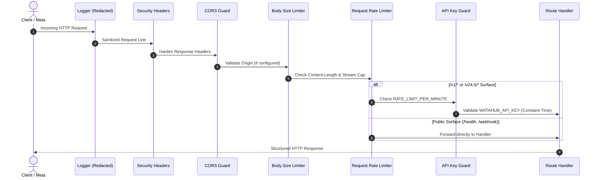
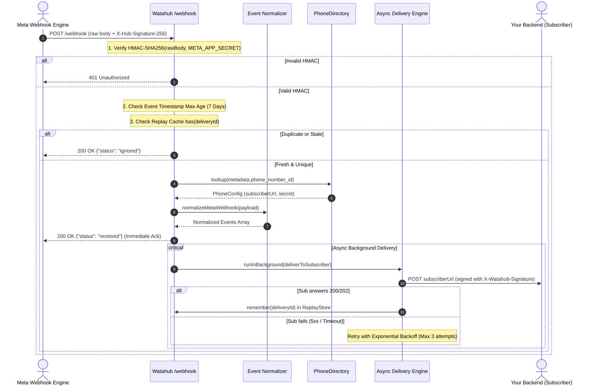
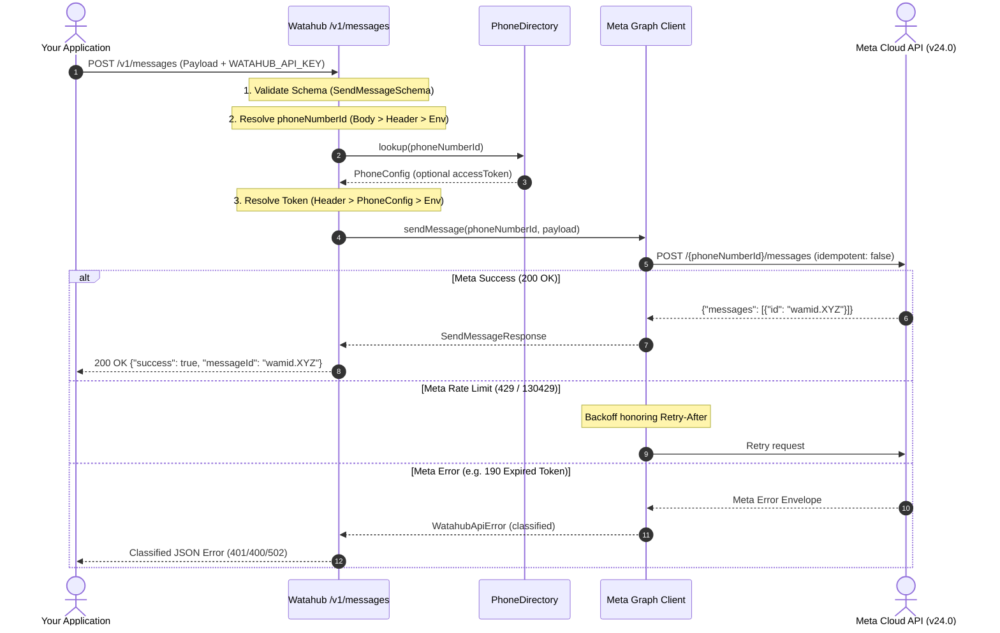
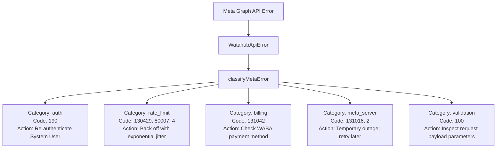

# 📐 Watahub Architecture & Technical Design

This document details the internal architecture, design principles, component boundaries, and request lifecycles of **Watahub**.

---

## 1. Design Philosophy

Watahub is built on three core architectural principles:

1. **Web Standards First:** Built with native Web APIs (`fetch`, `crypto.subtle`, `Headers`, `Request`, `Response`, `ReadableStream`). Core services have zero Node.js-specific dependencies, ensuring identical behavior across Cloudflare Workers, Node.js, and Bun.
2. **Ports and Adapters (Hexagonal Architecture):** Routes never instantiate concrete services directly. All infrastructure collaborators (Graph API client, state stores, timers, HTTP transports, and phone directories) are injected through the `GatewayDeps` interface.
3. **Fail-Closed Security Defaults:** If a cryptographic key, signing secret, or security parameter is missing, the gateway refuses execution with explicit HTTP error codes (`503`, `401`, `403`) rather than falling back to unauthenticated or insecure behavior.

---

## 2. System Architecture Diagram

```mermaid
flowchart TD
    subgraph Clients["Clients & External Actors"]
        WAUser["WhatsApp User"]
        AppServer["Your Application / Backend"]
    end

    subgraph MetaCloud["Meta Cloud API v24.0"]
        MetaGraph["Meta Graph API"]
        MetaWebhookSender["Meta Webhook Dispatcher"]
    end

    subgraph Watahub["🌊 Watahub Gateway (Hono)"]
        subgraph Middlewares["Security & Control Middleware"]
            M_SecHeaders["Security Headers (CSP, HSTS, DENY)"]
            M_ReqLog["Secret-Redacting Logger"]
            M_RateLimit["Per-Client Request Rate Limiter"]
            M_Auth["API Key Guard (Constant-Time)"]
            M_BodyLimit["Streaming Body Size Limiters"]
        end

        subgraph Routes["HTTP Route Handlers"]
            R_Health["GET /health"]
            R_Webhook["GET & POST /webhook"]
            R_Messages["POST /v1/messages"]
            R_Media["GET & POST /v1/media"]
            R_Templates["GET /v1/templates"]
            R_Onboarding["POST /v1/onboarding/*"]
            R_Proxy["ALL /v24.0/*"]
        end

        subgraph Ports["Pluggable Ports (GatewayDeps)"]
            P_PhoneDir["PhoneDirectory (Token & URL Lookup)"]
            P_Replay["ReplayStore (Deduplication)"]
            P_RateLimit["RateLimitStore (Failure Brakes)"]
            P_MetaClient["MetaGraphClient (Request Engine)"]
        end

        subgraph Services["Core Domain Services"]
            S_Crypto["Web Crypto (HMAC-SHA256, timingSafeEqual)"]
            S_Norm["Webhook Event Normalizer"]
            S_Delivery["Subscriber Async Delivery Engine"]
            S_Errors["Error Categorization Engine"]
        end
    end

    WAUser <--> MetaCloud
    MetaWebhookSender -->|POST /webhook| M_SecHeaders
    AppServer -->|POST /v1/messages| M_SecHeaders
    AppServer -->|POST /v1/media| M_SecHeaders
    AppServer -->|ALL /v24.0/*| M_SecHeaders

    Routes --> Ports
    Routes --> Services
    S_Delivery -->|POST (signed)| AppServer
    P_MetaClient -->|HTTPS fetch| MetaGraph
```

---

## 3. Middleware Pipeline & Execution Order

Every request passing through Watahub executes middleware in a strictly deterministic sequence:



### Execution Details:
1. **Redacting Logger (`src/index.ts`):** Strips `hub.verify_token`, `access_token`, `Bearer` tokens, and `x-api-key` values from logs before printing.
2. **Hardening Headers (`src/http/headers.ts`):** Sets `Content-Security-Policy: default-src 'none'`, `X-Frame-Options: DENY`, `X-Content-Type-Options: nosniff`.
3. **No-Store Cache Control (`src/http/headers.ts`):** Wraps `/v1/*` and `/v24.0/*` with `Cache-Control: no-store` so sensitive data is never cached in intermediate proxies.
4. **Body Limits (`src/http/limits.ts`):** 
   - Webhook deliveries: 3 MB limit.
   - Standard JSON APIs: 1 MB limit.
   - Media uploads: 100 MB limit (supporting WhatsApp document caps).
5. **Rate Limiting (`src/http/rate-limit.ts`):** Refuses request floods before invoking authentication checks to preserve CPU cycles.
6. **Authentication Guard (`src/http/auth.ts`):** Checks `WATAHUB_API_KEY` using constant-time comparison. Failed attempts trigger brute-force braking via `apiKeyLimiter`.

---

## 4. Inbound Webhook Lifecycle (`/webhook`)



---

## 5. Outbound Messaging Lifecycle (`POST /v1/messages`)



---

## 6. Ports & Adapters Architecture

Watahub achieves portability and modularity by defining four primary ports:

### 6.1 `PhoneDirectory` Port
Enables dynamic, multi-tenant credential and target routing per phone number:
```ts
export interface PhoneConfig {
  tenantId?: string
  accessToken?: string
  subscriberUrl?: string
  subscriberSecret?: string
}

export interface PhoneDirectory {
  lookup(phoneNumberId: string): Promise<PhoneConfig | null>
}
```
- **Implementations:**
  - `InMemoryPhoneDirectory`: Default in-memory Map implementation.
  - `DistributedPhoneDirectory`: Key-Value adapter backed by any `KeyValueStore` (Cloudflare KV, Redis, Durable Objects).

### 6.2 `ReplayStore` Port
Deduplicates webhook deliveries to guarantee at-most-once processing:
```ts
export interface ReplayStore {
  has(id: string, nowMs?: number): boolean | Promise<boolean>
  remember(id: string, nowMs?: number): boolean | Promise<boolean>
  clear(): void | Promise<void>
}
```
- **Implementations:**
  - `DeliveryIdCache`: In-memory implementation with automatic expiration cleanup.
  - `DistributedReplayStore`: Key-Value adapter with TTL support.

### 6.3 `RateLimitStore` Port
Provides brute-force attack prevention on authentication endpoints:
```ts
export interface RateLimitStore {
  blockedFor(key: string, nowMs?: number): number | Promise<number>
  hit(key: string, nowMs?: number): void | Promise<void>
  clear(): void | Promise<void>
}
```
- **Implementations:**
  - `FixedWindowLimiter`: In-memory fixed-window counter with key eviction cap.
  - `DistributedRateLimitStore`: Key-Value adapter with window expiration.

### 6.4 `MetaGraphClient` Port
Encapsulates communication with Meta's Graph API:
```ts
export interface MetaGraphClient {
  sendMessage(phoneNumberId: string, payload: SendMessagePayload): Promise<SendMessageResponse>
  listTemplates(wabaId: string): Promise<MetaMessageTemplate[]>
  exchangeCodeForToken(code: string, clientId: string, clientSecret: string): Promise<{ accessToken: string }>
  subscribeAppToWaba(wabaId: string, subscribedFields?: readonly string[]): Promise<boolean>
  overridePhoneNumberCallback(phoneNumberId: string, callbackUrl: string, verifyToken: string): Promise<boolean>
  getMediaUrl(mediaId: string): Promise<string>
  uploadMedia(phoneNumberId: string, body: BodyInit, contentType?: string): Promise<{ id: string }>
}
```

---

## 7. Error Handling & Normalization Architecture

Watahub transforms Meta Graph errors into classified, actionable responses:



### Response Redaction Guarantees:
- **Internal Traces:** Meta trace IDs (`fbtrace_id`) and debugging internals are scrubbed from HTTP responses to prevent information leakage.
- **Transport Failures:** DNS resolution failures, connection resets, and socket timeouts are mapped to generic 502/504 errors without exposing hostnames, IPs, or internal network topology.
