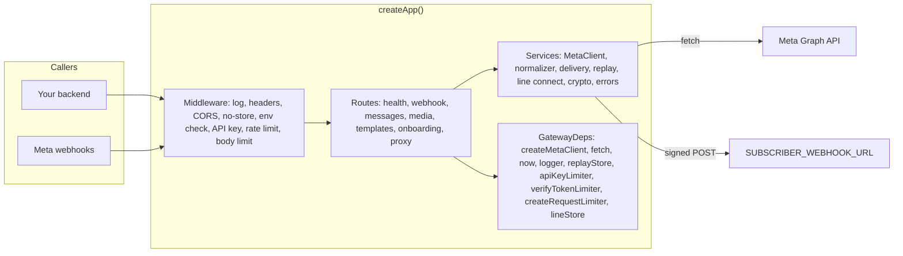
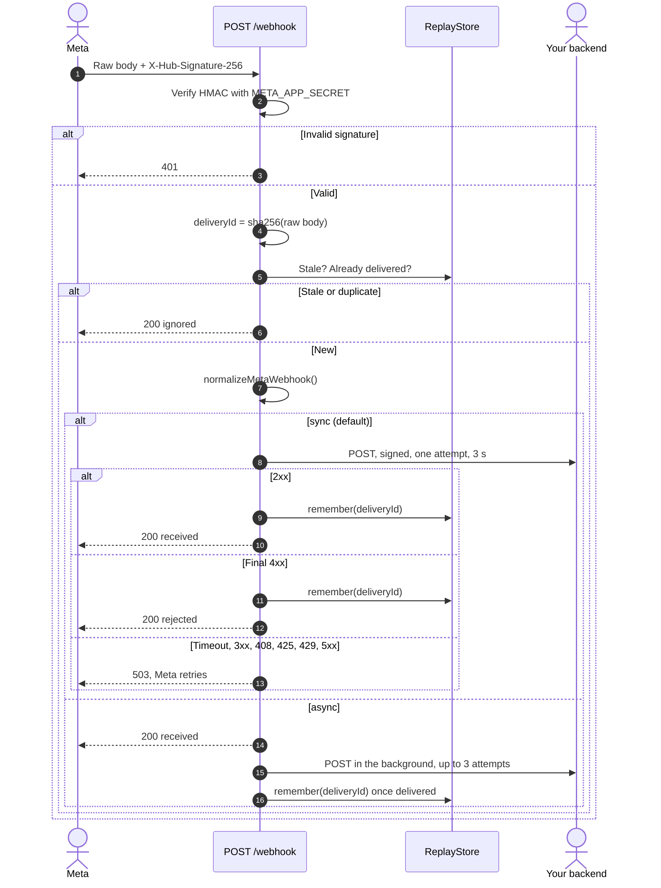
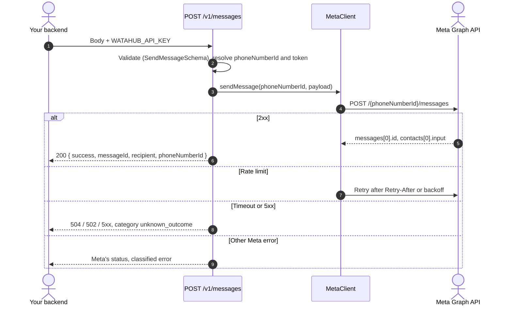
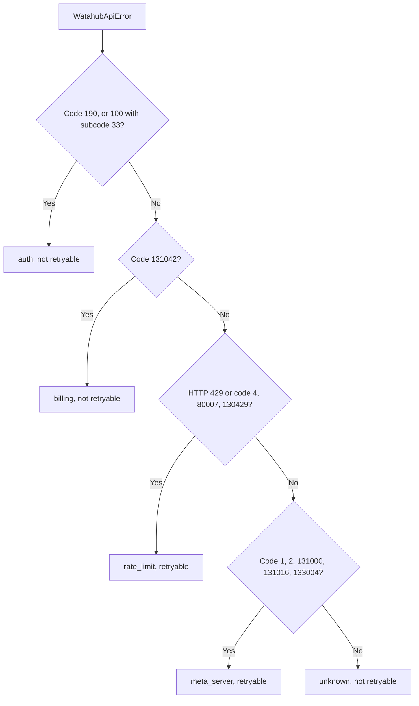

# Architecture

How the gateway is built: the request pipeline, the ports it depends on, and how it calls Meta and classifies Meta's
errors. The code layout and conventions are in [CONTRIBUTING.md](../CONTRIBUTING.md).

## 1. Principles

1. **Web platform APIs.** Services use `fetch`, `crypto.subtle`, `Headers`, `Request`, `Response` and
   `ReadableStream`, so the same code runs on Cloudflare Workers and Node.js. Only `src/node.ts` (the Node entry) and
   the `@hono/node-server` adapter are Node-specific.
2. **Injected collaborators.** Routes never build their own Meta client, clock, logger, `fetch` or stores. They come
   from `GatewayDeps`, which `createApp(overrides)` fills with defaults.
3. **Fail closed.** A missing or weak secret makes the routes that need it answer `503`. Missing configuration never
   falls back to unauthenticated behavior or a default credential.
4. **Thin routes.** A handler parses input, resolves the Meta client and config, calls one service method and maps
   failures with `errorResponse`.

## 2. Components



Dependencies point inwards: `routes` → `http` → `services` → `types`. Services never import from `http` or `routes`.

## 3. Middleware order

Hono runs middleware in the order `src/index.ts` registers it:

| # | Applies to | Middleware | Source |
| :--- | :--- | :--- | :--- |
| 1 | Every request | Request log line, with secret query values (`hub.verify_token`, `access_token`, `client_secret`, `code`, `input_token`, `appsecret_proof`, `refresh_token`) replaced by `[REDACTED]` | `utils/redact.ts` |
| 2 | Every request | Security headers: `Content-Security-Policy: default-src 'none'; frame-ancestors 'none'`, `X-Frame-Options: DENY`, HSTS, `nosniff`, `Referrer-Policy: no-referrer` | `http/headers.ts` |
| 3 | Every request | `503` if `CORS_ALLOWED_ORIGINS` is malformed | `http/env-guard.ts` |
| 4 | Every request | CORS, only for the origins in `CORS_ALLOWED_ORIGINS` | `http/cors.ts` |
| 5 | `/v1/*`, `/v24.0/*` | `Cache-Control: no-store` on every answer, errors included | `http/headers.ts` |
| 6 | `/v1/*`, `/v24.0/*` | `503` if `RATE_LIMIT_PER_MINUTE`, `TRUSTED_CLIENT_IP_HEADER` or (on `/v1`) `META_API_VERSION` is malformed | `http/env-guard.ts` |
| 7 | `/v1/*`, `/v24.0/*` | API key, compared in constant time; failed attempts are throttled per client | `http/auth.ts` |
| 8 | `/v1/*`, `/v24.0/*` | `RATE_LIMIT_PER_MINUTE`, counted only for authenticated requests | `http/rate-limit.ts` |
| 9 | `/webhook`, `/v1/*`, `/v24.0/*` | Body size limit: 3 MB, 1 MB, or 100 MB for media uploads | `http/limits.ts` |
| 10 | | Route handler | `routes/*.ts` |

The rate limit runs after the API key so callers without the key cannot spend a legitimate client's budget. Unknown
paths answer `404`; uncaught errors are logged with redaction and answer a generic `500`.

## 4. Inbound webhook



Details, headers and the event catalog are in [Webhooks and events](WEBHOOKS_AND_EVENTS.md).

## 5. Outbound calls to Meta

Every Graph call goes through one method, `MetaClient.request`, with a per-attempt timeout and bounded retries.

| Policy | Attempts | Timeout per attempt | Backoff |
| :--- | :--- | :--- | :--- |
| Graph calls (`DEFAULT_RETRY_POLICY`) | 3 | 15 s | Full jitter, 500 ms base, 8 s cap |
| Media upload | 1 | 60 s | None |
| Media download, proxy | 1 | 60 s | None |

What is retried depends on whether the call is safe to repeat:

| Failure | Idempotent calls (reads, subscribe, override callback) | Non-idempotent calls (send, code exchange, register) |
| :--- | :--- | :--- |
| Rate limit (HTTP `429`, codes `4`, `80007`, `130429`) | Retried, honoring `Retry-After` up to the cap | Retried: Meta did not process the request |
| Timeout, network error, `5xx`, transient codes | Retried with backoff | Not retried: the outcome is unknown |
| Other `4xx` | Not retried | Not retried |



## 6. Ports

`GatewayDeps` (`src/deps.ts`) lists every collaborator. `createApp(overrides)` fills the ones you do not pass.

| Port | Default | Purpose |
| :--- | :--- | :--- |
| `createMetaClient` | `new MetaClient({ fetch, ... })` | Builds the Graph client for one request |
| `fetch` | Global `fetch`, resolved per call | Proxy, media download and subscriber delivery |
| `now` | `Date.now` | Clock |
| `logger` | `console` | `info` and `error`; callers pass already-safe text |
| `replayStore` | `DeliveryIdCache`, in memory, shared by the process | Delivered webhook IDs |
| `apiKeyLimiter`, `verifyTokenLimiter` | `FixedWindowLimiter`, 10 per minute, in memory | Failed API keys and verify tokens |
| `createRequestLimiter` | One in-memory limiter per limit value | `RATE_LIMIT_PER_MINUTE` |
| `lineStore` | `MemoryLineStore`, one per `createApp()` | Business tokens stored by `connect` |

```ts
interface ReplayStore {
  has(id: string, nowMs?: number): boolean | Promise<boolean>
  remember(id: string, nowMs?: number, ttlSeconds?: number): boolean | Promise<boolean>
  clear(): void | Promise<void>
}

interface RateLimitStore {
  blockedFor(key: string, nowMs?: number): number | Promise<number>
  hit(key: string, nowMs?: number): void | Promise<void>
  clear(): void | Promise<void>
}

interface LineStore {
  get(phoneNumberId: string): Promise<StoredLine | undefined> | StoredLine | undefined
  put(line: StoredLine): Promise<void> | void
}

interface MetaGraphClient {
  sendMessage(phoneNumberId: string, payload: SendMessagePayload): Promise<SendMessageResponse>
  listTemplates(wabaId: string, after?: string): Promise<MetaTemplatePage>
  exchangeCodeForToken(code: string, clientId: string, clientSecret: string): Promise<{ accessToken: string }>
  subscribeAppToWaba(wabaId: string, subscribedFields?: readonly string[], overrideToken?: string): Promise<boolean>
  registerPhone(phoneNumberId: string, pin: string, overrideToken?: string): Promise<boolean>
  overridePhoneNumberCallback(phoneNumberId: string, callbackUrl: string, verifyToken: string): Promise<boolean>
  getMediaUrl(mediaId: string): Promise<string>
  uploadMedia(phoneNumberId: string, body: BodyInit, contentType?: string, overrideToken?: string): Promise<{ id: string }>
}
```

`DistributedReplayStore`, `DistributedRateLimitStore` and `DistributedLineStore` implement the first three over any
`KeyValueStore`; see [Extensions](MULTI_TENANCY_AND_EXTENSIONS.md). Watahub Enterprise Edition replaces
`createMetaClient`, `fetch`, `logger` and `lineStore` this way instead of changing the core.

## 7. Error classification

`MetaClient` throws `WatahubApiError` for every non-2xx Graph answer. `classifyMetaError` maps it, checking in this
order:



A message send that times out, loses its connection or gets a Meta `5xx` is reported as `unknown_outcome` instead,
because it may have been delivered.

What never reaches a response: Meta's `fbtrace_id`, transport error messages (they can carry hostnames and addresses)
and internal stack traces. Logs carry error names only.
