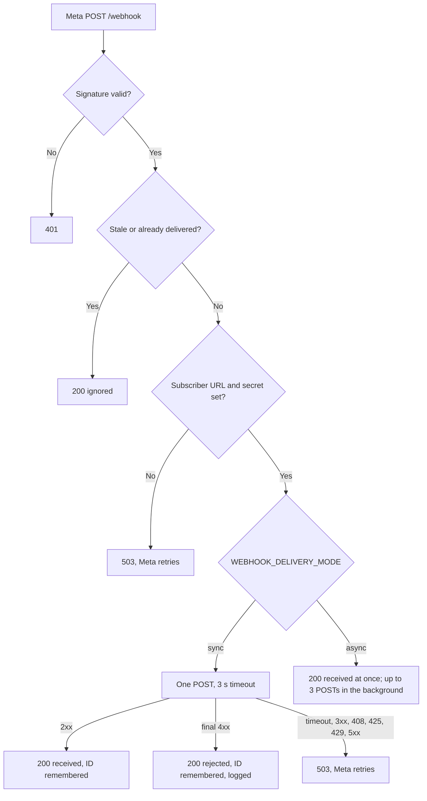

# Webhooks and events

How the gateway receives Meta's webhooks, what it forwards to your backend, how to verify it, and the shape of every
normalized event. Source of truth: `src/routes/webhook.ts`, `src/services/delivery.ts`, `src/services/replay.ts`,
`src/services/normalizer.ts` and `src/types/gateway.ts`.

## 1. Delivery lifecycle

For each `POST /webhook` from Meta:

1. **Configuration.** An invalid `WEBHOOK_DELIVERY_MODE` or `META_WEBHOOK_MAX_AGE_SECONDS`, or a missing
   `META_APP_SECRET`, answers `503` so Meta retries later.
2. **Signature.** `X-Hub-Signature-256` must be `sha256=` plus 64 hex characters, matching the HMAC-SHA256 of the raw
   body keyed with `META_APP_SECRET`. Otherwise `401`.
3. **Delivery ID.** The SHA-256 of the raw body. A Meta redelivery of the same body has the same ID.
4. **Age.** If the newest message, echo or status in the body is older than `META_WEBHOOK_MAX_AGE_SECONDS` (default 7
   days, Meta's retry horizon), the gateway answers `200` (`ignored`, `stale`) and forwards nothing. Updates without
   event timestamps, such as template status changes, are never treated as stale.
5. **Duplicates.** If this process already delivered the ID, it answers `200` (`ignored`, `duplicate`). A copy that
   arrives while the same body is still being delivered is not delivered again. In `sync` mode it waits for that
   delivery and answers `duplicate`, or `503` if the delivery failed; in `async` mode it answers `duplicate` at once.
6. **Empty deliveries.** A body with no changes is acknowledged with `200` and not forwarded.
7. **Subscriber.** Without `SUBSCRIBER_WEBHOOK_URL` or `SUBSCRIBER_WEBHOOK_SECRET` the gateway answers `503`, so Meta
   keeps the event until both are set.
8. **Forward.** It normalizes the body and posts `{ timestamp, events, raw }` to your URL.



### Delivery modes

**`sync` (default).** The gateway posts to your backend inside Meta's request: one attempt, a 3 second timeout, no
retries of its own.

- `2xx`: the gateway answers Meta `200` and remembers the delivery ID.
- Timeout, network error, redirect, `408`, `425`, `429` or `5xx`: it answers `503` and does not remember the ID, so
  Meta delivers the same body again. Meta retries failed deliveries for up to 7 days.
- Any other `4xx`: your backend refused the event for good. The gateway logs the rejection with the delivery ID,
  remembers the ID and answers `200`, so Meta stops. From then on the event exists only in the gateway log.

**`async`.** The gateway answers Meta `200` at once and delivers in the background (Workers `waitUntil`; on Node the
process tracks the task and waits up to 15 seconds for it on `SIGTERM` or `SIGINT`).

- Up to 3 attempts, 5 seconds each, waiting 1 and then 2 seconds between them. A final `4xx` stops after the first.
- Meta already has its `200`, so it never retries. A delivery that fails is lost, except for the gateway log.

Use `sync` unless your backend cannot answer within 3 seconds.

### Deduplicate on your side

The gateway remembers delivered IDs only inside one Node process or one Worker isolate. Another process or isolate can
deliver the same body again. Your backend must deduplicate on `x-watahub-delivery-id`, and treat the event as received
even when it already committed it but the gateway never saw the answer.

## 2. What your backend receives

```http
POST <SUBSCRIBER_WEBHOOK_URL>
Content-Type: application/json
User-Agent: Watahub-Gateway/0.2.0
x-watahub-signature: sha256=<lowercase hex>
x-watahub-delivery-id: <sha256 of Meta's body>
Idempotency-Key: <same as x-watahub-delivery-id>
```

Header names are case-insensitive; the block shows the casing the gateway sends. Redirects are not followed.

```ts
interface SubscriberPayload {
  timestamp: number // When the gateway processed the delivery, epoch milliseconds
  events: WatahubNormalizedEvent[]
  raw: unknown // Meta's original body, for fields the gateway does not normalize
}
```

Only `messages` and `smb_message_echoes` changes become events. Any other field you subscribe to (template status,
account updates and so on) still arrives, with `events: []` and the original in `raw`.

## 3. Verifying the signature

`x-watahub-signature` is `sha256=` followed by the lowercase hex HMAC-SHA256 of the exact body, keyed with
`SUBSCRIBER_WEBHOOK_SECRET` as text. No timestamp is signed, so the signature alone does not stop a replay: deduplicate
on the delivery ID.

> [!IMPORTANT]
> Compute the HMAC over the raw body, before any JSON parsing. Re-serialized JSON changes the bytes and the digest.

TypeScript, with the package (Node 20+, Workers, Bun):

```ts
import { verifySubscriberSignature } from 'watahub'

// rawBody is the request text before JSON.parse; a missing or malformed header answers false
const valid = await verifySubscriberSignature(rawBody, request.headers.get('x-watahub-signature'), secret)
```

TypeScript (Node), without the package:

```ts
import crypto from 'node:crypto'

export function verifyWatahubSignature(rawBody: string, signatureHeader: string, secret: string): boolean {
  if (!signatureHeader || !signatureHeader.startsWith('sha256=')) return false
  const provided = Buffer.from(signatureHeader.slice('sha256='.length).trim(), 'hex')
  const expected = crypto.createHmac('sha256', secret).update(rawBody).digest()
  return provided.length === expected.length && crypto.timingSafeEqual(provided, expected)
}
```

Python:

```python
import hashlib
import hmac

def verify_watahub_signature(raw_body: bytes, signature_header: str, secret: str) -> bool:
    if not signature_header or not signature_header.startswith("sha256="):
        return False
    provided = signature_header[len("sha256="):].strip()
    expected = hmac.new(secret.encode("utf-8"), raw_body, hashlib.sha256).hexdigest()
    return hmac.compare_digest(expected, provided)
```

Go:

```go
package main

import (
	"crypto/hmac"
	"crypto/sha256"
	"encoding/hex"
	"strings"
)

func VerifyWatahubSignature(rawBody []byte, signatureHeader, secret string) bool {
	if !strings.HasPrefix(signatureHeader, "sha256=") {
		return false
	}
	provided, err := hex.DecodeString(strings.TrimPrefix(signatureHeader, "sha256="))
	if err != nil {
		return false
	}
	mac := hmac.New(sha256.New, []byte(secret))
	mac.Write(rawBody)
	return hmac.Equal(mac.Sum(nil), provided)
}
```

The library also exports the signer the gateway uses, `signSubscriberPayload(body, secret)`, to build signed
deliveries in your own tests.

## 4. Normalized events

Every event has the same envelope:

| Field | Type | Description |
| :--- | :--- | :--- |
| `id` | string | Message ID (`wamid...`); for statuses, `<message id>_<status>` |
| `timestamp` | number | Meta's event time, epoch milliseconds |
| `phoneNumberId` | string | Your phone number ID that received or sent it |
| `displayPhoneNumber` | string | That number as Meta displays it |
| `type` | string | `message`, `echo` or `status` |
| `message` | object | For `message` and `echo` |
| `status` | object | For `status` |

Within one change, inbound messages and echoes come before status updates.

### 4.1 Message fields

| Field | Present when |
| :--- | :--- |
| `id`, `timestamp`, `kind` | Always. `kind` is Meta's message `type` |
| `from` | The sender's phone number, when Meta shares it. Never a BSUID |
| `fromUserId`, `fromParentUserId` | The sender's business-scoped user ID, and the parent BSUID for businesses enrolled in them |
| `username`, `senderName` | The sender's WhatsApp username and profile name, when Meta sends them |
| `replyToMessageId` | The message replies to another (`context.id`) |
| `referral` | The conversation started from a click-to-WhatsApp ad: `sourceType`, `sourceId`, `sourceUrl`, `headline`, `body`, `mediaType`, `imageUrl`, `videoUrl`, `thumbnailUrl`, `ctwaClid` |

Content by `kind`:

| `kind` | Fields |
| :--- | :--- |
| `text` | `text` |
| `image`, `video` | `mediaId`, `mediaMime`, `caption` |
| `audio` | `mediaId`, `mediaMime`, `isVoice` |
| `document` | `mediaId`, `mediaMime`, `filename`, `caption` |
| `sticker` | `mediaId`, `mediaMime` (default `image/webp`), `animated` |
| `interactive` | `interactiveReply` for a reply button (`type: "button"`), a list row (`type: "list"`) or a Flow answer (`type: "nfm_reply"`); `pollVote` for a poll update |
| `button` | A template quick-reply: `text`, `button: { payload, text }`, and the same in `interactiveReply` (`type: "button"`) |
| `reaction` | `reaction: { targetMessageId, emoji }`; an empty `emoji` means the reaction was removed |
| `location` | `location: { latitude, longitude, name?, address?, url? }` |
| `contacts` | `contacts`: contact cards in the request shape |
| `order` | `order: { catalogId, text?, productItems: [{ productRetailerId, quantity, itemPrice, currency }] }` |
| `poll`, `poll_update` | `pollVote: { pollMessageId, selectedOptionIds, timestamp? }` |
| Anything else | The common fields only; the full message is in `raw` |

Download a `mediaId` with `GET /v1/media/:mediaId/content`.

### 4.2 Text

```json
{
  "id": "wamid.HBgLNTczMDAxMjM0NTY3FQIAEhgg...",
  "timestamp": 1762615800000,
  "phoneNumberId": "100609346426000",
  "displayPhoneNumber": "15550293848",
  "type": "message",
  "message": {
    "id": "wamid.HBgLNTczMDAxMjM0NTY3FQIAEhgg...",
    "from": "573001234567",
    "senderName": "Jane Doe",
    "timestamp": 1762615800000,
    "kind": "text",
    "text": "I need help with my account."
  }
}
```

**Users with a WhatsApp username.** Meta identifies every user with a business-scoped user ID (BSUID, for example
`CO.13491208655302741918`). A user who has a username and does not share their number arrives without `from`
([Meta's guide](https://developers.facebook.com/documentation/business-messaging/whatsapp/business-scoped-user-ids/)).
Key your users on `fromUserId`:

```json
"message": {
  "id": "wamid.HBgLNTczMDAxMjM0NTY3FQIAEhgg...",
  "fromUserId": "CO.13491208655302741918",
  "username": "jane.doe",
  "senderName": "Jane Doe",
  "timestamp": 1762615800000,
  "kind": "text",
  "text": "I need help with my account."
}
```

To reply, send to the BSUID: `POST /v1/messages` accepts it in `to`.

### 4.3 Media

```json
"message": {
  "id": "wamid.HBgLNTczMDAxMjM0NTY3FQIAEhgg...",
  "from": "573001234567",
  "timestamp": 1762615800000,
  "kind": "image",
  "mediaId": "987654321098765",
  "mediaMime": "image/jpeg",
  "caption": "Photo of the damaged package"
}
```

### 4.4 Reply button and list row

```json
"message": {
  "id": "wamid.HBgLNTczMDAxMjM0NTY3FQIAEhgg...",
  "from": "573001234567",
  "timestamp": 1762615800000,
  "kind": "interactive",
  "interactiveReply": { "type": "button", "id": "confirm", "title": "Confirm" }
}
```

A list row has `"type": "list"` with the row's `id` and `title`.

### 4.5 Flow answer

`interactiveReply` has `"type": "nfm_reply"`, the Flow `name` and `body`, and the parsed answer in `responseJson`. If
Meta's `response_json` is not a JSON object, `responseJson` is absent and `"responseJsonError": true` says so, so an
unreadable answer is never mistaken for an empty one.

```json
"interactiveReply": {
  "type": "nfm_reply",
  "name": "flow",
  "body": "Sent",
  "responseJson": { "flow_token": "booking-42", "date": "2026-11-20" }
}
```

### 4.6 Reaction

```json
"message": {
  "id": "wamid.HBgLNTczMDAxMjM0NTY3FQIAEhgg...",
  "from": "573001234567",
  "timestamp": 1762615800000,
  "kind": "reaction",
  "reaction": { "targetMessageId": "wamid.ORIGINAL...", "emoji": "❤️" }
}
```

### 4.7 Echo

Sent when someone replies from the WhatsApp Business app on a number that also uses the Cloud API. Subscribe to the
`smb_message_echoes` field to receive it. The customer is in `recipient` (phone, when shared), `recipientUserId` and
`recipientParentUserId`.

```json
{
  "id": "wamid.HBgLNTczMDAxMjM0NTY3FQIAEhgg...",
  "timestamp": 1762615800000,
  "phoneNumberId": "100609346426000",
  "displayPhoneNumber": "15550293848",
  "type": "echo",
  "message": {
    "id": "wamid.HBgLNTczMDAxMjM0NTY3FQIAEhgg...",
    "from": "15550293848",
    "recipient": "573001234567",
    "timestamp": 1762615800000,
    "kind": "text",
    "text": "Replying from the phone.",
    "isEcho": true
  }
}
```

### 4.8 Status

One event per status change: `sent`, `delivered`, `read` or `failed`. The recipient is in `recipient` (phone, when
shared), `recipientUserId` and `recipientParentUserId`. `category` is Meta's pricing category.

```json
{
  "id": "wamid.HBgLNTczMDAxMjM0NTY3FQIAEhgg..._delivered",
  "timestamp": 1762615805000,
  "phoneNumberId": "100609346426000",
  "displayPhoneNumber": "15550293848",
  "type": "status",
  "status": {
    "id": "wamid.HBgLNTczMDAxMjM0NTY3FQIAEhgg...",
    "recipient": "573001234567",
    "status": "delivered",
    "timestamp": 1762615805000,
    "category": "service"
  }
}
```

A failure carries Meta's first error:

```json
"status": {
  "id": "wamid.HBgLNTczMDAxMjM0NTY3FQIAEhgg...",
  "recipient": "573001234567",
  "status": "failed",
  "timestamp": 1762615805000,
  "errorCode": 131026,
  "errorMessage": "Message undeliverable"
}
```
